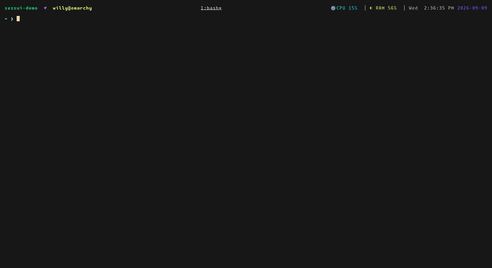

# sessui

A tmux session switcher in a popup. Shows what every session is doing — local
and on your other machines — and gets out of the way.



## Install

**TPM** — add to `~/.config/tmux/tmux.conf`, then `prefix + I`:

```tmux
set -g @plugin 'WillyV3/sessui'
```

TPM fetches the release binary for your machine (Linux or macOS, amd64 or
arm64) and checks it against the release's checksums. No Go needed.

**Go:**

```sh
go install github.com/WillyV3/sessui@latest
```

**Neither** — grab a binary from
[releases](https://github.com/WillyV3/sessui/releases/latest), put it on your
PATH, and bind it yourself:

```tmux
bind-key s display-popup -E -w 112 -h 26 sessui
```

A popup larger than the terminal is an error in tmux. The TPM install shrinks
it to fit; with your own binding, use sizes like `-w 90% -h 80%` if you work
in small windows.

Needs **tmux 3.7+**. Earlier versions open the popup but never redraw it.
Before 3.3, `transparent` and `borderless` have no effect (see
[Settings](#settings)).

## Keys

| Key | Does |
|-----|------|
| `↑` `↓` | move |
| any letter | filter — no `/` |
| `enter` | switch, or create a session named by the filter |
| `←` `→` | while creating: pick which machine |
| `ctrl+r` | rename |
| `ctrl+x` | kill |
| `ctrl+e` | settings — columns, width, theme, icons, hosts |
| `esc` | close |

Letters filter, so there are no `j`/`k` keys. Arrows are the nav.

## Other machines

`ctrl+e`, arrow down to **hosts**. Your `~/.ssh/config` is already the list —
`space` watches one and its sessions join the table.

```
hosts   ● build-box   ● laptop 1   ○ desk-pi   ○ old-mac   ›
```

`●` up · `○` down · `◌` still asking. Reachable machines sort first. Nothing is
polled until you pick something. Put the cursor on a `○` and the row says what
ssh said — a mistyped name, a sleeping laptop and a captive portal are
different problems.

Outside tmux, `sessui -hosts` prints the same thing as text: every host, its
sessions, or why it did not answer.

`enter` on a remote session attaches over ssh inside a local session named
`host/name`. After that it's a normal local session — instant to switch back to,
and it stops showing twice. Kill and rename work on it too.

Inside a remote session there is one tmux, the far one. Your local tmux steps
aside for that session: its prefix, its shortcuts and its status line are off,
so every key and click goes to the machine you are looking at. Your other
sessions are untouched.

- **Back:** detach (`prefix d`). The view closes and you are in the local
  session you came from. The remote session keeps running.
- **Copying:** selection and copy mode are the far tmux's. What you copy
  reaches this machine's clipboard only with `set -g set-clipboard on` in
  your local tmux.conf; tmux's default keeps it on the far machine.
- **Stuck connection:** `enter` `~` `.` makes ssh hang up, which does the same.
  A dead connection also closes by itself after about 45 seconds.
- **sessui on the far machine too:** `prefix s` there opens that machine's
  list, and its own sessions switch as usual. It will not open a session on a
  third machine from inside your view, or lead you back to the one you are
  sitting at: it tells you to detach and open it from your own machine.

Creating: type a name, `←→` to pick a machine, `enter`. Plain `enter` still
creates locally.

**Needs:** `ssh -o BatchMode=yes <host> true` works (key auth, no prompt), and
tmux on the far end. Nothing gets installed there. Since it shells out to `ssh`,
your `~/.ssh/config` does the work — ProxyJump, certs, agent forwarding,
Tailscale names.

## Settings

`ctrl+e` edits the real table, live. `esc` applies, `ctrl+z` throws it away,
`ctrl+r` resets.

Popup size lives in tmux, because tmux needs it before sessui starts:

| Option | Default | |
|--------|---------|--|
| `@sessui-key` | `s` | `prefix + <key>` |
| `@sessui-width` | `112` | the table wants ~112 columns |
| `@sessui-height` | `26` | |

Everything else is `~/.config/sessui/config.json`, written for you by `ctrl+e`:

| Key | Values | |
|-----|--------|--|
| `icons` | `nerd` \| `ascii` | `ascii` for terminals without a Nerd Font |
| `theme.palette` | `auto` \| `dark` \| `light` | `auto` follows [Omarchy](https://omarchy.org) |
| `transparent` | `false` \| `true` | the popup takes the terminal's background (wallpaper, blur) instead of tmux's `popup-style`; next open (TPM popup, see below) |
| `borderless` | `false` \| `true` | a flush edge instead of tmux's popup border; next open (TPM popup, see below) |
| `columns` | `[{"id","width"}]` | which columns, in what order |
| `hosts` | `["alias"]` | machines to watch |

The TPM popup looks like any other tmux popup: your `popup-border-lines`,
`popup-border-style` and `popup-style`. Two rows in `ctrl+e` change that, and
both show the next time you open sessui:

- **fill** `transparent` gives the fill the terminal's background. The border
  keeps its lines and colour.
- **border** `off` replaces the border with a row of blank cells in the popup's
  own style, so a solid popup is one flush block. A drawn line sits in the
  middle of its cell, so a fill could only stop short of it or run past it.

Both need tmux 3.3+ (`display-popup -b`, `-s`, `-S`). Before that, the popup is
bound exactly as before. A binding of your own doesn't get either, so these
two rows only work with the TPM popup.

tmux reads them through `@sessui-transparent` and `@sessui-borderless`. sessui
manages those options: it copies them from `config.json` when the plugin loads
and when `ctrl+e` applies, and a value you set yourself is overwritten. If you
edit `config.json` by hand (or a dotfiles sync does), reload your tmux.conf
before the change shows.

## When an agent needs you

A session stopped on a question or a permission prompt moves to the top of the
list, blinks, and says what it is waiting for:

```
needs you · approve Bash: make install
```

sessui does not read the agent's screen to learn this. The agent says so
itself, with the [program status protocol](https://www.superlogical.com/rex/docs/build/program-status)
(OSC 7501), and tmux passes it on. Nothing here is specific to one agent:
whatever speaks the protocol is heard, in any pane, on this machine or
another. Tested with Claude Code and pi, neither of which needed any setup.

tmux carries the protocol from the version after 3.8 (its main branch since
November 2026), and an agent only starts reporting once it is restarted inside
one. On an older tmux the terminal bell is all there is: a session that rings
shows `needs you` until you visit it. A bell cannot say what for, and an agent
set to ring when it finishes a turn will read the same as one asking.

## With cp3

Running [cp3](https://github.com/WillyV3/cp3)? sessui matches
each session to its peer by directory and adds a `peer` column — up or down,
what it's working on, `✉` when it owes you a reply. No config; it reads
`cp3 peers` if `cp3` is there. Without it the column disappears.

## Docs

[Architecture](docs/ARCHITECTURE.md) · [Security](docs/SECURITY.md) · [Gotchas](docs/GOTCHAS.md)

## License

MIT
